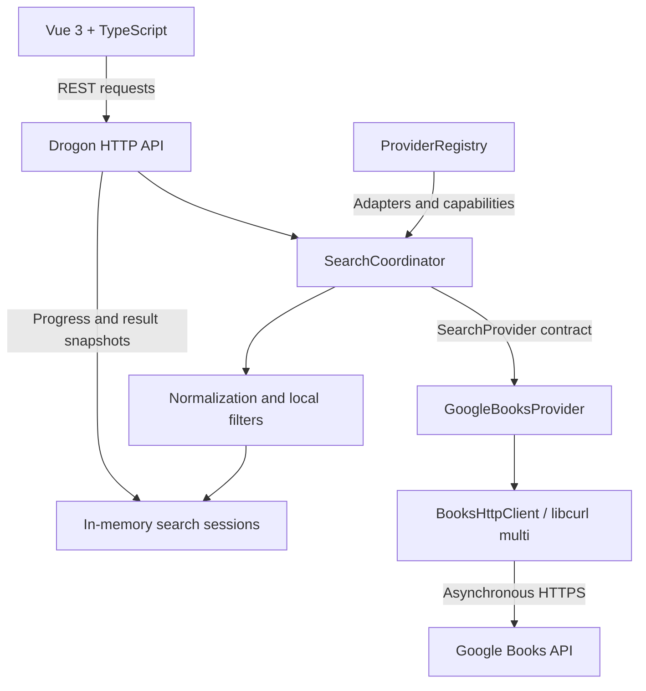

<a id="readme-top"></a>

<div align="center">

  

  <h1>LiberOmnia</h1>

  <p><strong>Discover books across digital libraries.</strong></p>

  <p>
    A federated bibliographic search application built with C++20 and Vue 3.<br>
    Search titles, authors, subjects and passages while preserving each source's metadata, provenance and access conditions.
  </p>

  <p>
    <a href="#library-integrations"></a>
    <a href="#google-books-configuration"></a>
    <a href="LICENSE"></a>
  </p>

  <p>
    
    
    
    
    
    
    
    
    
  </p>

  <p>
    <a href="#local-setup">Run locally</a> ·
    <a href="#architecture-and-limits">Architecture</a> ·
    <a href="#tests-and-quality">Tests</a> ·
    <a href="#author-and-contact">Contact</a>
  </p>

</div>

> [!NOTE]
> The backend, search sessions and frontend are implemented. Google Books is the
> first real integration, but searches depend on backend configuration and available
> Google Cloud quota. A connected backend does not guarantee an available external
> library. The application never substitutes demonstration books for real results.

## Contents

- [Overview](#overview)
- [Features](#features)
- [Library integrations](#library-integrations)
- [Search and filters](#search-and-filters)
- [Reading and downloads](#reading-and-downloads)
- [Architecture and limits](#architecture-and-limits)
- [Bibliographic model](#bibliographic-model)
- [Technology stack](#technology-stack)
- [Project structure](#project-structure)
- [Local setup](#local-setup)
- [Google Books configuration](#google-books-configuration)
- [Environment variables](#environment-variables)
- [HTTP API and sessions](#http-api-and-sessions)
- [Security and privacy](#security-and-privacy)
- [Tests and quality](#tests-and-quality)
- [Current limitations](#current-limitations)
- [References](#references)
- [License](#license)
- [Author and contact](#author-and-contact)

## Overview

LiberOmnia brings bibliographic discovery into a single search workspace. Its
federated engine coordinates independent library adapters, normalizes their records
and keeps the identity of each edition and its original source intact.

The interface uses a compact dark layout with a library strip, sidebar navigation,
advanced filters and a source-status panel. Results show bibliographic information,
source excerpts and the reading or download links actually supplied by the library.

A central distinction is the difference between **finding a bibliographic record**,
**finding textual evidence**, and **being allowed to read or download a book**.
LiberOmnia presents those separately instead of treating one as proof of another.

## Features

| Area | Implemented functionality |
| --- | --- |
| Search | General queries, title, author, subject and quoted passages. |
| Filters | Seven languages, custom publication intervals, century presets and access availability. |
| Sessions | Asynchronous execution, source progress, bounded polling and cooperative cancellation. |
| Bibliography | Titles, subtitles, authors, publishers, edition dates, languages and source identifiers when supplied. |
| Access | Distinct full/partial viewing, PDF, EPUB, restricted access and metadata-only states. |
| Diagnostics | Configuration status, last successful operation, typed errors and shared request limits. |
| Interface | Responsive dark workspace, synchronized quick search, keyboard navigation and visible focus. |
| Verification | Controlled HTTP clients, C++ tests, HTTP integration tests and frontend tests independent of Google. |

## Library integrations

| Library | Integration | Current state |
| --- | --- | --- |
| **Google Books** | Bibliographic API | Implemented; application identification and usable quota are required. |
| Internet Archive | Planned API adapter | Not implemented; unavailable for search. |
| Open Library | Planned API adapter | Not implemented; unavailable for search. |
| Gallica | Planned API adapter | Not implemented; unavailable for search. |
| Anna's Archive | Planned external integration | No API search is implemented. |

The library strip and selection controls read `GET /api/sources`. Planned sources
cannot be selected as if they could answer live queries. Operational status is
tracked separately from the existence of an implemented adapter.

## Search and filters

- General searches send the query through `q`. Title, author and subject searches
  use `intitle:`, `inauthor:` and `subject:` with quoted terms.
- Passage searches quote the phrase. Google Books does not guarantee full-text
  access, a verified occurrence, or a page location. `searchInfo.textSnippet` is
  classified as `source_excerpt`, displayed as untrusted plain text, and never
  promoted to a confirmed occurrence. HTML markup in snippets remains visible text.
- Languages use native `langRestrict`: `pt`, `en`, `fr`, `la`, `es`, `it`, `de`, or
  no restriction. Other codes, regional tags and alternate spellings are rejected
  by this adapter with `provider_invalid_request`; source language metadata is
  preserved rather than rewritten.
- Publication intervals are inclusive and local. Any valid years in 1–9999 are
  accepted, including 1501–1600, 1701–1800, 1801–1900 and 1901–2000. The UI includes
  a 19th-century preset and custom bounds. Only the **edition's** `publishedDate`
  is used. Strict `YYYY`, `YYYY-MM`, and `YYYY-MM-DD` parsing validates real calendar
  dates; missing, ambiguous and invalid dates never acquire an estimated year.
- Availability is filtered locally from normalized access information. Unknown
  fields cannot satisfy a specific date or access filter.

Local filters apply to a bounded set of retrieved candidates, not the complete
Google Books catalog. The coordinator preserves the original request and applies
these filters after retrieval. The adapter receives the native filters only.
The UI asks for up to 40 candidates; the HTTP API accepts 1–100 per source. Narrow
historical filters may yield no results even when matching editions exist elsewhere
in the catalog. No century-wide search or exhaustive coverage is claimed.

### Field-search fallback

When the initial title, author or subject query succeeds with `totalItems: 0`, the
adapter may issue **one** alternative general request within its total call budget.
It retains only candidates whose title, individual author, or category contains all
query tokens. Matching uses token boundaries and ASCII case folding; non-ASCII
bytes are preserved, so accented case variants may be missed. Missing metadata
cannot verify a match. No fallback follows an HTTP error, a nonempty native page,
or an exhausted call budget. The alternative is never paginated.

`fallbackUsed`, `localFiltersApplied` and `coverageIncomplete` expose this behavior.
Fallback matches are metadata matches, not exact phrase matches or evidence of
exhaustive native field search. The interface marks these results explicitly.

## Reading and downloads

`ALL_PAGES` and `PARTIAL` are distinct viewing states. Full viewing or public-domain
status alone never implies a PDF or EPUB download. A download requires an explicit,
validated `downloadLink` and `isAvailable: true`. ACS-token access is labeled
restricted; tokens are not exposed as public downloads. A format reported as
available without a public link is not offered as a download.

Official canonical, information, preview and reader links are used when supplied;
URLs are never synthesized. Both backend and frontend reject unsafe links. External
links use `noopener noreferrer`. Availability, public-domain assertions and viewing
rights apply to the country reported by the source and may differ elsewhere.
This stage does not download, store or redistribute books.

## Architecture and limits



`GoogleBooksProvider` implements the existing asynchronous `SearchProvider`
contract and is explicitly registered in `ProviderRegistry`. The federated
`SearchCoordinator` has no Google Books name checks or query logic. It retains
normalization, session budgets, cancellation, local filtering and provenance.
Generic additions carry typed errors, dynamic provider status and fallback/limit
information through the session API.

`BooksHttpClient` is replaceable in tests. Its production implementation uses
libcurl multi socket callbacks on the Drogon/Trantor application event loop.
Sockets and timer deadlines drive I/O; there are no blocking network calls,
detached threads, sleep loops or periodic network polling. HTTPS certificates and
hostnames are verified, redirects are not followed, and asynchronous DNS support
is required. A streaming body callback enforces the response-size limit before
JSON parsing. Headers are capped at 32 KiB; JSON depth and metadata sizes are bounded.

Each search owns its callback state and stop registration. Completion happens once;
duplicate and late transport callbacks cannot add results after completion.
Cancellation acknowledges promptly and schedules transport teardown on its loop.
One page is in flight per search. Defaults and hard ceilings are:

| Limit | Default | Ceiling |
| --- | --- | --- |
| Results per upstream page | 40 | 40 |
| Native pages per search | 3 | 10 |
| Calls per search, including fallback | 4 | 11 |
| Search deadline in adapter | 6 seconds | 30 seconds |
| Response body per call | 1 MiB | 4 MiB |
| Concurrent Google calls across searches | 4 | Fixed process-wide default |
| Google calls in a rolling minute | 30 | Fixed process-wide default |
| UI candidates per source | 40 | API maximum 100 |

The result cap can stop pagination before the page budget. The single fallback may
follow a one-page native budget but always consumes the call budget. No automatic
retry is performed. Shared rate limiting rejects excess work immediately, without
sleeping. Temporary limits use a shared `Retry-After` cooldown (60 seconds when
absent or invalid). Daily quota evidence instead blocks the current configuration
without scheduling a retry. HTTP 403 quota reasons receive the same structured
classification. These limits apply within one process, not across multiple replicas.

The adapter distinguishes network failure, authentication, access blocking, quota
limits, invalid responses, server errors, timeout, cancellation and legitimate
empty responses. Records from successful pages survive later failures. Missing
required identity/title fields are rejected; invalid optional dates remain without
a year. Deduplication uses only `(sourceId, sourceRecordId)`. Equal titles never
merge editions, and absent work/edition IDs are not invented. `totalItems` is an
estimate; Google Books results always retain `coverageIncomplete: true`.

## Bibliographic model

| Concept | Responsibility |
| --- | --- |
| `SearchRequest` | Query, search field, source selection and original filter bounds. |
| `BibliographicRecord` | Source metadata, edition identity, identifiers, access information and textual evidence. |
| `(sourceId, sourceRecordId)` | Deduplication identity; title similarity never merges distinct editions. |
| Publication date | Date of the retrieved edition; the original publication of a work is a separate concept. |
| Access information | Actual viewing conditions and format links supplied by the source. |
| Textual evidence | Distinguishes a source excerpt from a verified occurrence or an approximate match. |
| Normalized result | A normalized record alongside its bounded structured original metadata. |

Missing metadata remains absent. LiberOmnia does not invent publication years,
page numbers, download URLs, work IDs or edition IDs.

## Technology stack

| Layer | Technologies and use |
| --- | --- |
| Backend | **C++20**, **Drogon 1.9** and Trantor for HTTP routes and asynchronous execution. |
| External HTTP | **libcurl multi**, TLS verification, asynchronous DNS and bounded response reception. |
| Frontend | **Vue 3**, **TypeScript 5.9**, **Vite 8** and responsive CSS without a CSS framework. |
| Build | **CMake 3.24+** and a C++20 compiler. |
| Backend tests | **GoogleTest** and Python HTTP integration suites. |
| Frontend tests | **Vitest 5**, Vue Test Utils, jsdom and `vue-tsc`. |
| Persistence boundary | SQLite linkage is reserved for future persistence; this stage does not open a database. |

Frontend dependency versions are locked in [`frontend/package-lock.json`](frontend/package-lock.json).
The backend build requirements are defined in [`backend/CMakeLists.txt`](backend/CMakeLists.txt).

## Project structure

```text
liberomnia/
├── backend/
│   ├── include/liberomnia/    # Domain models and provider/session contracts
│   ├── src/                  # HTTP routes, coordinator, normalization and adapters
│   ├── tests/                # C++ tests and loopback HTTP integration suites
│   └── CMakeLists.txt
├── frontend/
│   ├── public/               # Static application assets
│   ├── src/
│   │   ├── components/       # Search, filters, results and source status
│   │   ├── composables/      # Form state, catalog loading and session lifecycle
│   │   ├── services/         # HTTP clients and operational diagnostics
│   │   └── types/            # TypeScript API contracts
│   ├── tests/                # Vitest suites
│   └── package.json
├── docs/images/readme/       # README cover
├── .env.example
├── CMakeLists.txt
├── LICENSE
└── README.md
```

## Local setup

### Prerequisites

Linux, C++20, CMake 3.24+, Drogon 1.9.x, libcurl 7.85+ with TLS and asynchronous DNS,
SQLite development headers, GoogleTest, Python 3.10+, and Node.js 22.12+/24.x/26+
are required. Tested dependencies include Drogon 1.9.14, libcurl 8.23.0, Vue 3.5.44,
TypeScript 5.9.3 and Vite 8.3.5. Frontend dependencies are locked in
`frontend/package-lock.json`. SQLite is reserved for future persistence; no database
is opened by this stage.

On Debian/Ubuntu, an administrator can install prerequisites manually:

```sh
sudo apt-get install build-essential cmake pkg-config curl python3 \
  libjsoncpp-dev libssl-dev zlib1g-dev uuid-dev libsqlite3-dev libgtest-dev \
  libcurl4-openssl-dev
```

<details>
<summary>Build pinned Drogon and Trantor dependencies in a local prefix</summary>

Use a compatible distribution Drogon package or build pinned sources locally:

```sh
deps_dir="$(mktemp -d /tmp/liberomnia-deps.XXXXXX)"
deps_prefix="$deps_dir/install"
curl -fL https://github.com/drogonframework/drogon/archive/refs/tags/v1.9.14.tar.gz \
  -o "$deps_dir/drogon.tar.gz"
tar -xzf "$deps_dir/drogon.tar.gz" -C "$deps_dir"
curl -fL https://github.com/an-tao/trantor/archive/78e480f5e138acdc05f76c55a2716718cd846364.tar.gz \
  -o "$deps_dir/trantor.tar.gz"
tar -xzf "$deps_dir/trantor.tar.gz" \
  -C "$deps_dir/drogon-1.9.14/trantor" --strip-components=1
cmake -S "$deps_dir/drogon-1.9.14" -B "$deps_dir/build" \
  -DCMAKE_BUILD_TYPE=Release -DCMAKE_INSTALL_PREFIX="$deps_prefix" \
  -DBUILD_CTL=OFF -DBUILD_EXAMPLES=OFF -DBUILD_TESTING=OFF \
  -DBUILD_ORM=OFF -DBUILD_BROTLI=OFF -DBUILD_YAML_CONFIG=OFF
cmake --build "$deps_dir/build" --parallel 4
cmake --install "$deps_dir/build"
```


</details>

Keep the prefix available while building; `/tmp` may be cleaned on reboot. A
persistent user-owned directory can be used instead. If npm's default cache is
unwritable, use `npm --prefix frontend ci --cache /tmp/liberomnia-npm-cache`.

### Build and start

From the repository root:

```sh
npm --prefix frontend ci
cmake -S . -B build -DCMAKE_BUILD_TYPE=Debug -DCMAKE_PREFIX_PATH="$deps_prefix"
cmake --build build --parallel 4
test -f .env || cp .env.example .env
set -a
. ./.env
set +a
./build/backend/liberomnia_server
```

Omit `CMAKE_PREFIX_PATH` for a system Drogon installation. The backend also supports
`cmake -S backend -B build/backend-only` and `-DBUILD_TESTING=OFF`.
The executable reads environment variables, not `.env` files directly.

In another terminal run `npm --prefix frontend run dev` and open
**http://localhost:5173**. Vite proxies `/api` to **http://127.0.0.1:8080**.
`npm --prefix frontend run build` creates a production bundle; deploy it behind a
web server with an `/api` reverse proxy. The API does not serve frontend files.

| Service | Local address |
| --- | --- |
| Vue frontend | http://localhost:5173 |
| Backend health | http://127.0.0.1:8080/api/health |
| Library catalog | http://127.0.0.1:8080/api/sources |

The empty key in `.env.example` lets the backend and interface start with Google
Books marked as not configured. Follow the next section to enable real searches.

## Google Books configuration

The [official Google Books usage guide](https://developers.google.com/books/docs/v1/using#auth)
requires application identification even for public data, using an API key or OAuth.
LiberOmnia currently implements backend API-key identification, not OAuth. Calls
without a key are not a supported operating mode: an empty `GOOGLE_BOOKS_API_KEY`
produces `configuration_required` and sends no external request. Historical anonymous
responses do not establish reliable access or a usable quota.

To configure the integration, an administrator should:

1. Select the intended project in Google Cloud Console and enable **Books API**
   (`books.googleapis.com`) under **APIs & Services > Library**.
2. Create or review an API key under **APIs & Services > Credentials**. Restrict it
   to Books API and use application restrictions compatible with backend traffic
   (browser referrer restrictions cannot identify this server).
3. Supply `GOOGLE_BOOKS_API_KEY` through the backend process environment or an
   ignored local environment file. The application does not load `.env` automatically.
   Keep `GOOGLE_BOOKS_ENABLED=true`. Never put credentials in frontend code, `VITE_`
   variables, tracked files, command-line URLs, logs or screenshots.
4. Inspect **APIs & Services > Books API > Quotas & System Limits** in that project.
   Check the relevant daily and per-minute limits, overrides and usage. A zero limit
   requires administrative review or a quota adjustment; enabling the API or adding
   a key alone does not guarantee an allocation. No quota value is assumed here.
5. After correcting credentials, restrictions, API enablement or confirming restored
   quota, restart the backend to load configuration and clear the administrative
   block. Then refresh the catalog and deliberately submit a new search. Restarting
   is not itself a remedy for unavailable quota; do not automate restart/retry loops.

Startup performs **zero Google Books searches**. An enabled, configured adapter is
`unverified` and can accept its first user search. A valid response records the last
successful operation time. `/api/health` reports backend health only.
`/api/sources` adds an optional `operational` object: `implemented`, `configured`,
`searchAllowed`, `state`, `lastSuccessfulAt` (Unix seconds or null), and a fixed,
redacted `error`. Existing `implementationStatus` remains a compatibility admission
signal; `available` there means a search can be attempted, not that Google has
already responded successfully. Planned libraries retain their existing contracts.

The UI distinguishes missing configuration, an unverified service, last observed
success, temporary failures and exhausted quota. It refreshes the catalog when a
session finishes. **Atualizar catálogo** only reads local status; it never probes
Google or clears administrative blocks. Query text, filters and selected source
preferences survive temporary unavailability. After a cooldown, refresh the catalog
to enable a deliberate new search. There are no background probes or automatic retries.

| Diagnostic | Behavior and administrative action |
| --- | --- |
| 400 with an invalid-key reason | Configuration block; review the credential. An unclassified 400 requires configuration review without asserting a specific cause. |
| 401 / unauthenticated | Credential block; review identification. |
| 403 | Inspect the typed reason: API disabled, incompatible key restrictions, or permission denied. HTTP status alone does not identify Cloud project settings. |
| 429 / resource exhausted, daily evidence | Daily quota block; zero is distinguished when explicitly reported. No immediate retry and no invented reset time. Verify quota before recovery. |
| Temporary rate limit / per-minute evidence | Shared cooldown follows `Retry-After` seconds or HTTP date. Missing/invalid headers use a 60-second local cooldown; this does not assert Google's reset time. An unspecified 429 does not imply a particular quota period. |
| Network, timeout, invalid response, 5xx | Preserve partial results and diagnostics; a 5-second local cooldown (or longer `Retry-After`) permits a later user request. |

Reasons and quota evidence are read from structured Google error fields and, where
needed, explicit quota wording. Raw messages, metadata, project identifiers and
credentials are never copied into public diagnostics. Concurrent or late successes
cannot erase a daily-quota/configuration block. State is in memory for the current
process; no unauthenticated public reset endpoint is provided. Cloud changes do not
reach the running process automatically. See [Google error conventions](https://google.aip.dev/193)
and [quota troubleshooting](https://cloud.google.com/docs/quotas/troubleshoot).

## Environment variables

Defaults are documented in [`.env.example`](.env.example). Keep real credentials
in the backend environment or an ignored local file.

| Variable | Default | Purpose || --- | --- | --- |
| `LIBEROMNIA_ADDRESS` | `127.0.0.1` | Numeric listener address |
| `LIBEROMNIA_PORT` | `8080` | Listener port |
| `LIBEROMNIA_DATA_DIR` | `./data` | Drogon runtime directory root |
| `LIBEROMNIA_FRONTEND_ORIGIN` | `http://localhost:5173` | Exact CORS origin; empty disables CORS |
| `LIBEROMNIA_SEARCH_CONCURRENCY` | `4` | Concurrent provider executions |
| `LIBEROMNIA_SEARCH_MAX_PENDING` | `64` | Queued provider work |
| `LIBEROMNIA_SEARCH_MAX_SESSIONS` | `32` | Active and retained sessions |
| `LIBEROMNIA_SEARCH_MAX_RECORDS` | `200` | Records per session |
| `LIBEROMNIA_SEARCH_TIMEOUT_MS` | `8000` | Coordinator deadline |
| `LIBEROMNIA_SEARCH_SESSION_TTL_MS` | `900000` | Session retention |
| `GOOGLE_BOOKS_ENABLED` | `true` | `false` disables searches; startup never probes |
| `GOOGLE_BOOKS_API_KEY` | Empty | Backend application identification; empty disables searches |
| `GOOGLE_BOOKS_PAGE_SIZE` | `40` | Upstream page size |
| `GOOGLE_BOOKS_MAX_PAGES` | `3` | Native page budget |
| `GOOGLE_BOOKS_CALL_BUDGET` | `4` | Total calls, including fallback |
| `GOOGLE_BOOKS_TIMEOUT_MS` | `6000` | Adapter deadline across all pages |
| `GOOGLE_BOOKS_MAX_RESPONSE_BYTES` | `1048576` | Streaming body limit |

Invalid configuration fails startup without printing credentials. Coordinator
deadlines may end searches earlier than adapter limits. Public Google Books access
is subject to project, regional and quota restrictions; an empty key is not a
supported anonymous access mode.

## HTTP API and sessions

| Endpoint | Successful response |
| --- | --- |
| `GET /api/health` | Versioned application health |
| `GET /api/sources` | `searchAvailable` and source capabilities/status |
| `POST /api/search` | 202, `{apiVersion, session}` and `Location` |
| `GET /api/search/{id}` | `{apiVersion, session}` |
| `GET /api/search/{id}/results` | `{apiVersion, session, results}` |
| `POST /api/search/{id}/cancel` | Idempotent cancellation with preserved results |

```json
{
  "text": "Thomas Aquinas",
  "field": "author",
  "sourceIds": ["google-books"],
  "language": "la",
  "publication": {"from": 1801, "to": 1900},
  "maxResultsPerSource": 40
}
```

Optional `availability` accepts `viewable`, `pdf`, `epub`, `restricted`,
`metadata_only`, or `unknown`. Null/omitted filters mean unrestricted. Unknown
properties, duplicate JSON keys, invalid types, invalid ranges and unknown sources
are rejected. No selected operational adapter returns 503. Invalid requests return
422, and local session/work limits return 429. Source failures inside accepted
sessions are typed progress states, not HTTP errors on the polling endpoint.
Results contain normalized `record` and bounded structured `original` values.

`useSearchSession` polls the results endpoint, which also contains progress, at
750 ms after each response. It stops on completion, cancellation or disconnection,
and is bounded by 60 polls and 60 seconds. Retrying progress does not reset those
limits. Each HTTP request has an 8-second timeout. Generation guards prevent stale
results replacing a new search; unmount aborts pending requests. Complete result
snapshots replace prior snapshots to prevent duplicates. No WebSockets or SSE are
used. Disconnection preserves received results and offers bounded resumption.
A session whose creation response is lost expires on the server even if its ID
could not be recovered for cancellation.

## Security and privacy

Sessions live only in memory, expire after 15 minutes by default, and disappear on
restart. No reusable upstream response cache or persistent search history is
created. Responses to the browser use `Cache-Control: no-store`. Search text, API
keys, upstream request URLs and upstream error bodies are not logged. A session ID
is an unguessable bearer identifier; this stage has no authentication or ownership
isolation, and the default listener is loopback.

- The API validates JSON shape, field types, source identifiers and resource limits.
- Source snippets are rendered as plain text; external HTML is not inserted into the DOM.
- Links are validated and external navigation uses `noopener noreferrer`.
- HTTPS upstream requests verify certificates and hostnames; redirects are disabled.
- Credentials and Google account/project metadata are excluded from public diagnostics.
- Book files are not stored or redistributed by the application.

## Tests and quality

```sh
ctest --test-dir build --output-on-failure
npm --prefix frontend run typecheck
npm --prefix frontend test
npm --prefix frontend run build
git diff --check
```

Normal tests never depend on Google. GoogleTest substitutes a controlled HTTP
client and covers queries/encoding, date/language validation, metadata/access,
fallback, pagination, budgets, partial failures, callback lifetime, startup without probes, typed quota diagnostics and recovery.
Four HTTP test runs across three Python suites exercise startup/CORS, federated sessions, and the real
Google Books adapter with a fixture transport over loopback. Fixture servers are
separate test executables and cannot inject demonstration data into production.
Vitest covers form submission, API result rendering, source selection/catalog
refresh, cancellation, bounded polling, stale responses, disconnects and XSS.
Use `ctest --test-dir build -E 'http_.*integration' --output-on-failure` when local
socket binding is unavailable.

The external diagnostic is opt-in and is **not** registered with CTest:

```sh
cmake -S . -B build -DCMAKE_PREFIX_PATH="$deps_prefix" -DLIBEROMNIA_LIVE_CHECK=ON
cmake --build build --target liberomnia_books_live --parallel 4
./build/backend/liberomnia_books_live --quota-confirmed
```

Run it only after configuring the API and verifying that one call fits the available quota.
The explicit flag acknowledges that check. Without configuration or the flag it exits
without sending a request. It makes at most one query for *The Imitation of Christ* (up to three results), reports the
real upstream status, and compares returned identities, titles and publication
metadata against the response received in that same request. Exit 0 means a valid
response, 1 a comparison failure, and 2 an upstream failure. Do not treat 403, 429,
timeout or unexpected zero results as fabricated success or bypass access controls.

For an optional ThreadSanitizer build on a supported host:

```sh
cmake -S . -B /tmp/liberomnia-tsan -DCMAKE_PREFIX_PATH="$deps_prefix" \
  -DCMAKE_BUILD_TYPE=Debug -DCMAKE_CXX_FLAGS='-fsanitize=thread -g -O1 -fno-omit-frame-pointer' \
  -DCMAKE_EXE_LINKER_FLAGS=-fsanitize=thread \
  -DCMAKE_GTEST_DISCOVER_TESTS_DISCOVERY_MODE=PRE_TEST
cmake --build /tmp/liberomnia-tsan --parallel 4
ctest --test-dir /tmp/liberomnia-tsan --output-on-failure
```

## Current limitations

- Google Books searches depend on credentials, API enablement, restrictions and
  quota managed by the operator in Google Cloud.
- Local filters and field-search fallback do not provide exhaustive catalog coverage.
- Source snippets do not guarantee full-text access or a verified page location.
- Viewing and download availability can differ by country and rights conditions.
- Rate controls and administrative blocks apply within one backend process, not
  across a distributed deployment.
- Search sessions expire and do not survive restart; authentication, private search
  history, OCR and cross-source work/edition matching are not implemented.
- Internet Archive, Open Library, Gallica and the external Anna's Archive integration
  remain planned.

## References

Implementation follows the [usage guide](https://developers.google.com/books/docs/v1/using),
[volumes.list parameters](https://developers.google.com/books/docs/v1/reference/volumes/list),
and [Volume resource](https://developers.google.com/books/docs/v1/reference/volumes).
Operators must comply with the [Google Books terms](https://developers.google.com/books/terms)
and [Google API terms](https://developers.google.com/terms/), including attribution,
content removal, privacy and permitted content retention. Provide rights-holder
contact information when publishing an installation. No scraping, CAPTCHA bypass,
book redistribution, paid access unlocking or persistent upstream caching is included.

## License

The source code is distributed under the [MIT License](LICENSE).
Copyright © 2026 Jefferson Tadeu dos Santos.

## Author and contact

<div align="center">

  <p><strong>Jefferson Tadeu dos Santos</strong></p>

  <p>
    <a href="https://jeffersontadeu.vercel.app">
      
    </a>
    <a href="https://github.com/auhauhbr">
      
    </a>
    <a href="https://www.linkedin.com/in/jefferson-tadeu-dos-santos-0ab133380">
      
    </a>
  </p>

  <p><a href="mailto:tadeu.santos7148@gmail.com">tadeu.santos7148@gmail.com</a></p>

</div>

<p align="right">(<a href="#readme-top">back to top</a>)</p>
